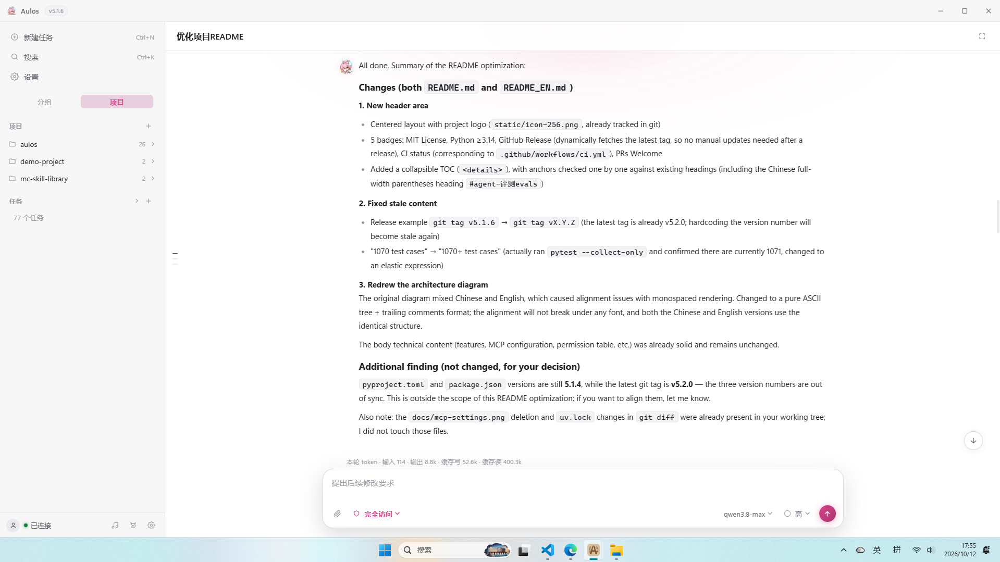

<div align="center">


# Aulos

**中文** | [English](README_EN.md)

[](LICENSE)
[](https://www.python.org/)
[](https://github.com/Steve-pixel-cpu/aulos/releases)
[](https://github.com/Steve-pixel-cpu/aulos/actions/workflows/ci.yml)
[](#项目来源与致谢)

一个本地运行的 AI 编程 Agent，完整开源。你用自然语言下任务，它自己
读文件、改代码、跑命令、查资料，直到把活干完。提供终端和桌面端两种用法，
并内置：安全权限体系、长对话自动压缩、外部工具接入（MCP）、多 Agent 并行、
自动化评测、会话保存与恢复。

</div>

<details>
<summary><b>目录</b></summary>

- [功能特性](#功能特性)
- [架构总览](#架构总览)
- [快速开始](#快速开始)
- [MCP 配置](#mcp-配置)
- [Agent 评测（evals/）](#agent-评测evals)
- [配置与权限](#配置与权限)
- [桌面端打包与发版](#桌面端打包与发版)
- [测试](#测试)
- [深入阅读](#深入阅读)
- [彩蛋小游戏：Aulos Dig](#彩蛋小游戏aulos-dig)
- [项目来源与致谢](#项目来源与致谢)
- [免责声明](#免责声明)
- [License](#license)

</details>

> Python 3.14 + FastAPI + Tauri 2。不绑定官方 API：任何兼容 Anthropic /
> OpenAI 接口的模型服务都能用（接口地址、Key、模型均可自定义）。
>
> 38k 行 Python 内核 ｜ 1000+ 测试用例 ｜ 6 类评测任务 + 基线回归 ｜
>
> 本项目基于 [MiniCC](https://github.com/Louisym/MiniCC) 开发并扩展而来
> （行级对比 92% 为重写/新增），详见[致谢](#项目来源与致谢)。

<table>
  <tr>
    <td width="50%"></td>
    <td width="50%"></td>
  </tr>
  <tr>
    <td align="center">浅色主题</td>
    <td align="center">深色主题</td>
  </tr>
</table>

## 功能特性

**Agent 内核**

- 工具循环：模型自己决定调用哪个工具（读文件、改代码、跑命令……），
  工具执行完把结果喂回给模型继续思考，循环直到任务完成。回复逐字流式
  输出，模型的思考过程（thinking 块）实时可见；每轮有 token 和迭代次数
  上限，快超限时会提醒模型尽快收尾给出结果，而不是干耗
- 免交互模式（Headless）：`main.py -p "任务" --output-format json`
  一条命令跑完一个任务并输出 JSON，方便脚本调用，也是评测框架的基础
- 多 Agent 编排：主 Agent（Leader）可以派生多个子 Agent（subagent）
  并行干活，适合互不依赖的多线任务；子 Agent 不能再派生（白名单控制，
  防止无限套娃），程序重启时会把上次进程遗留的「运行中」子 Agent 自动
  标记为失败，不留幽灵任务

**长对话不爆上下文（上下文工程）**

对话越长，塞给模型的内容越多，迟早超出模型的上下文窗口。本项目用三层
压缩自动"瘦身"：

1. **MicroCompact**：把老旧的大段工具输出替换成占位说明（如「此处原有
   200 行文件内容」），纯字符串操作，不花钱不调模型
2. **Session Memory**：后台线程持续把对话滚动总结成摘要，随用随取；
   增量消化（攒够一批才动、单飞行防并发）、消化失败指针不动下轮重试
3. **Full Compact**：以上都不够时，专门调一次模型，把整段对话压成
   结构化摘要；滚动摘要已覆盖归档区时直接复用（零额外调用），
   部分覆盖时只对增量做摘要

可靠性设计：

- **摘要漂移对冲**：LLM 滚动摘要多代接力，误差会单调累积——归档区
  每次压缩时由代码（不经模型）从原文机械抽取助手结论逐字锚点，拼在
  摘要之后。锚点永不经过模型改写，是摘要出错时的忠实底座
- **熔断降级**：摘要 LLM 调用连续失败达到阈值，本会话自动停用 LLM
  摘要、降级为规则摘要（统计 + 最近请求 + 待办 + 结论原文拼接），
  压缩链路永远不会因为模型不可用而断供

另有主上下文瘦身细节：工具输出过长时只保留开头几行、全文存到磁盘按需
再取；同一文件没变化却被重复读取时自动去重；贴的截图自动缩小尺寸；
大范围调研类任务引导模型派子 Agent 去干，结果只回传结论；同一个只读
操作重复第 3 次直接拒绝——防止模型陷入"反复读同一个文件"的死循环。

提示词排版对缓存友好：把不变的部分（系统提示、工具定义）固定在前、
变化的对话放后面，让供应商的 prompt cache 尽量命中，省钱省时。

**工具与生态**

- 内置常用工具：`bash`/`powershell`（跑命令）、`read_file`/`write_file`/
  `edit_file`（读写改文件）、`grep`/`glob`（搜索）、后台任务、`todo`
  （任务清单）、`web_search`/`web_fetch`（联网搜索与抓网页）；还有一组
  Playwright 浏览器工具，能打开真实浏览器点击、输入，实测网页功能
- MCP 客户端：MCP 是给 AI 接外部工具的标准协议，本项目支持
  `stdio`（本地子进程）/`http`/`sse` 三种接法，接入的工具以
  `mcp__<服务器名>__<工具名>` 注册，详见 [MCP 配置](#mcp-配置)
- Skills 技能包：兼容 Claude Code 的 `SKILL.md` 格式。平时模型只看每个
  技能的一行简介，需要时才读全文（渐进式披露），装几十个技能也不占上下文
- 跨会话记忆：对话中让模型"记住某事"，或手动 `/memory add`；下次新会话
  自动带上。容量满了按使用频率和新近度自动淘汰旧记忆

**可靠性与观测**

- 三级权限体系，从严到宽：`plan`（只读）→ `workspace-write`（工作目录内
  可写）→ `danger-full-access`（全放行）。超出当前权限的操作会先弹窗
  请求你批准；`.git/`、`~/.ssh/` 等敏感路径的写入删除，**任何模式下都
  强制人工确认**，防止不可逆破坏和模型偷改自己的权限配置
- 遇到 API 限流自动重试，且每次等待间隔加倍（指数退避）；回复因长度
  上限被截断时自动续写；每轮调用的耗时和 token 用量都记录到日志
- 会话持久化：对话过程实时增量写入 JSONL 文件（原子写，进程崩了也不会
  写坏）；下次可以 `-c` 接着聊、`--resume <id>` 恢复指定会话、
  `--list` 列出历史；多个进程同时跑互不干扰

**界面**

- 终端交互界面（斜杠命令、语法高亮、流式渲染）与 Tauri 2 桌面端
  （设置页、多供应商切换、计划卡片）；还内置摸鱼电台（网易云/B站）
  和桌宠悬浮窗

## 架构总览

```
CLI (main.py)                          # 终端交互 / 免交互模式
Desktop shell (src-tauri)              # 桌面壳, 走 WebSocket / REST
  |
  +-> aulos/server.py                  # FastAPI 后端门面
  |     +-> aulos/web/                 #   各功能域的 REST 接口
  |     +-> aulos/radio/               #   电台曲库(网易云 / B站)
  |
  +-> aulos/runtime.py                 # Agent 主循环(核心)
        +-> api_client / tools         #   模型调用客户端 / 内置工具
        +-> permissions / compact      #   权限审批 / 三层压缩
        +-> multi_agent / skills       #   子 Agent / 技能包
        +-> memory / mcp_client        #   跨会话记忆 / MCP 接入
        +-> config / storage           #   配置合并 / 会话存储
                                       # 数据目录: ~/.aulos/
```

全部 Python 实现收在 **`aulos/`** 包内；根目录只留 `main.py` / `server.py`
两个启动入口（内容只有几行，转发到包里的真实现；evals、桌面壳与打包脚本
硬编码了这两个路径，勿删）。

| 位置 | 职责 |
|---|---|
| `main.py` / `server.py`（根） | 启动入口：分别转发到 `aulos.main` / `aulos.server` |
| `aulos/main.py` / `aulos/server.py` | 终端入口 / Web 后端门面（统一转出各模块的公共接口） |
| `aulos/runtime.py` | Agent 主循环：事件流、并行执行工具、随时打断、预算控制、防死循环护栏 |
| `aulos/api_client.py` `tools.py` `permissions.py` `compact.py` 等 | 模型调用+自动重试 / 内置工具 / 权限审批 / 三层压缩（内核模块） |
| `aulos/web/` | 后端功能域：公共基座 + 电台/桌宠/遥测/设置/权限策略的 REST 接口 |
| `aulos/radio/` | 摸鱼电台曲库：网易云音乐与 B 站的抓取解析 |
| `aulos/memory/` `skills.py` `mcp_client.py` `multi_agent.py` | 跨会话记忆 / 技能包 / MCP 接入 / 多 Agent 编排 |
| `aulos/config.py` `storage.py` | 三级配置查找合并 / 会话 JSONL 存储 |
| `static/` `src-tauri/` | Web 前端（原生 JS，按功能域拆分文件）/ Tauri 2 桌面壳（Electron 壳已弃用） |

## 快速开始

### 环境要求

- **Python ≥ 3.14**，推荐用 [uv](https://docs.astral.sh/uv/) 管理依赖
- **Git for Windows**（Windows 必装）——本项目执行命令依赖 Git Bash：
  它对 UTF-8 输出原样直通，而 PowerShell 按 GBK 转码会乱码。检测不到
  Git Bash 会拒绝启动
- 只有打包桌面端才额外需要 Rust 工具链（cargo）与 Node.js

### 安装与配置

```bash
uv sync
```

终端版读项目根的 `.env` 文件，写一行 `API_KEY=sk-xxx` 即可。
Web/桌面端不读 `.env`：首次启动进入初始化页，在界面里填 API Key、
接口地址、模型，配置存到 `~/.aulos/settings.json`，支持多供应商切换。

**执行层模型分层**：设置页"模型"区可为子代理（subagent）单独指定更便宜的
模型（`workerProvider`）——主对话继续用强模型做诊断与规划，派出去的子代理
用便宜模型执行，省钱且不牺牲决策质量。未配置时子代理跟主对话模型。

### 启动

```bash
uv run python main.py                    # 终端新会话（-c 继续上次 / --resume <id> / --list）
uv run python main.py -p "任务" --output-format json   # 免交互单命令
uv run python server.py                  # Web 后端, 默认 http://127.0.0.1:8000
```

终端斜杠命令：`/help` `/status` `/compact` `/mode` `/thinking` `/rename`
`/skills` `/memory` `/exit`。Web 端与终端共享会话记录和工具集；想要完整
图形界面（自定义标题栏/计划卡片/电台/桌宠）请用桌面端打包产物。

## MCP 配置

在任意一层配置 JSON 里加 `mcpServers`（层级见[配置与权限](#配置与权限)）：

```json
{
  "mcpServers": {
    "filesystem": { "type": "stdio", "command": "npx",
      "args": ["-y", "@modelcontextprotocol/server-filesystem", "D:/tmp"] },
    "remote-tools": { "type": "http", "url": "https://example.com/mcp",
      "headers": { "Authorization": "Bearer <token>" }, "timeout": 30 }
  }
}
```

- `type` 支持 `stdio`（把 MCP 服务作为本地子进程拉起，可配
  `args`/`env`/`cwd`）、`http`、`sse`（连远程服务）
- 接入的工具命名为 `mcp__<服务器名>__<工具名>`，与内置工具永不冲突；
  某台 MCP 服务连不上只会告警，不影响启动
- 外部工具和内置工具走同一套权限审批、钩子、输出截断逻辑；没有专门
  配置权限的外部工具，默认保守处理——每次使用都先问你
- 桌面端设置页提供可视化管理

## Agent 评测（evals/）

给真实的 Agent（不是模拟）派预设任务，自动打分，检验改动有没有让能力
退步：每个任务附带一个小型示例项目（夹具），Agent 用 `main.py -p` 跑完
后，先用脚本做机械检查（如"测试是否通过"），再让另一个模型按评分标准
打分；结果存为基线（baseline），下次跑完自动对比。

```bash
uv run python evals/run_evals.py                    # 跑全部, 有基线则自动对比
uv run python evals/run_evals.py --only fix-failing-test --save-baseline
```

- 内置任务（6 类能力面）：数函数（count-functions）、修复失败测试
  （fix-failing-test）、实现函数（implement-function）、跨文件重命名
  （rename-across-files）、审查问题代码（review-buggy-code）、派子
  Agent（delegate-subagent）——覆盖实现、调试、重构、审查、编排五类
  典型 Agent 工作场景
- 添加任务：在 `evals/tasks/<名字>/` 下放 `task.txt`（任务描述）+
  `project/`（示例项目）+ 可选的 `checks.py`（机械检查）/
  `judge.txt`（给评分模型的评分标准）。注意跑真任务会消耗 token，
  建议先用 `--only` 挑单个小任务试
- CI：每天夜里跑全量 + 每次提交用假 Agent（不调真模型）做冒烟测试
  （`.github/workflows/evals.yml`）

## 配置与权限

配置分三层，按优先级从低到高深度合并（后者的同名项覆盖前者）：
`~/.aulos/settings.json`（用户全局）→ `<项目>/.claude/settings.json`
（项目级，可提交进仓库共享给团队）→ `.claude/settings.local.json`
（个人本地，不提交）。

配置项与 Claude Code 兼容：`model` / `thinkingLevel` / `permissionMode` /
`timeout` / `maxIterations` / `tokenBudget` / `turnTokenBudget` /
`contextWindow` / `mcpServers` / `hooks`；环境变量 `CLAUDE_MODEL` 等
同名项可覆盖文件配置。

> 注意：如果你走第三方中转 API，实际可用的上下文窗口常比官方小，务必把
> `contextWindow` 调小——压缩阈值按它自动推导（默认按 1M 窗口的 75%
> 计算），不调会导致对话超限报错。

| 权限模式 | 说明 |
|---|---|
| `plan` | 只读：读文件、搜索放行；任何写操作直接拒绝（引导你切换模式或先批准计划） |
| `workspace-write` | 工作目录内可写文件、可派生子 Agent；但执行命令仍需你逐个批准 |
| `danger-full-access` | 全放行，包括任意命令 |

超出当前模式的操作会弹审批（终端里是 y/N 确认面板，Web 里是审批卡片），
你可以单次放行。敏感路径（`.git/`、`~/.ssh/` 等）的写入和删除在任何模式
下——包括全放行——都强制人工确认，防止不可逆破坏，也防止模型修改自己的
权限配置来"自我放权"。

调用遥测：每次模型调用的耗时和用量都记录到
`~/.aulos/logs/runtime-YYYYMMDD.log`；浏览器打开 `/stats.html` 可看统计
面板：哪轮慢、token 花在哪、缓存命中率多少。

## 桌面端打包与发版

```cmd
build-exe.cmd          :: Windows 一键: 先把 Python 后端打成独立 exe, 再 cargo tauri build
```

macOS/Linux 用 `build-mac.sh` / `scripts/build-linux-tauri.sh`。发版只需
打 tag：`git tag vX.Y.Z && git push origin vX.Y.Z`，GitHub Actions 自动
构建并发布三个平台的安装包（Windows `.exe` / macOS `.dmg` /
Linux `.AppImage`），均带自动更新。细节见 [PACKAGING.md](PACKAGING.md)
与 [docs/desktop-release-notes.md](docs/desktop-release-notes.md)
（Linux 依赖、Wayland/VMware 显示问题排查、签名密钥）。

## 测试

```bash
uv run pytest          # 1070+ 用例；CI: .github/workflows/ci.yml
```

覆盖 Agent 主循环、权限与敏感路径、多 Agent、三层压缩、MCP、记忆、
技能包、评测框架、自动重试、原子写入、并发会话、上下文瘦身等。
前端回归：`npm run test:web`（jsdom 环境）+ `tests/web/e2e.py`
（Playwright 真实浏览器）。

## 深入阅读

- [guides/](guides/)：13 篇按模块拆解的实现笔记（读源码的伴侣文档）


## 彩蛋小游戏：Aulos Dig

宣传站（`website/`，纯静态页）里藏了一个 2D 像素风挖矿小游戏彩蛋：打开
`website/index.html#egg-run` 直达，或在页面里双击桌宠菲比进入。引擎为
本地打包的 Phaser 3（MIT，`website/js/vendor/phaser.min.js`），全部游戏
代码在 `website/js/game2.js`，无任何网络依赖，离线可玩。玩法：挖矿收集
水晶、昼夜循环与血月、越深越克苏鲁的地下怪物、宝箱战利品与武器升级、
二段跳；标题栏 ⚙ 打开 13 项参数配置页（血量/水晶目标/昼夜时长/血月概率
等），⛶ 一键全屏。

### 美术素材出处

- **方块图集** `assets/mc/tiles.png`：保留 CC0 来源像素包的手绘形状，经
  `website/tools/build_terraria_tiles.py` 全局调色 + 逐 tile 覆盖，重映射
  为 Terraria 风格配色；火把/宝箱/岩浆/砂砾/基岩/墙体贴图为程序化自绘。
  CC0 来源包（`assets/mc/src/blocks_2021.zip` / `blocks_2023.zip`）内无
  作者元数据，原始作者不可考，素材本身已进入公有领域
- **角色菲比** `assets/feibi/`：《鸣潮》(Wuthering Waves) 角色「菲比」的
  同人 chibi 桌宠素材；仓库内未记录原作者与授权信息，仅作非商业彩蛋展示
- **角色蓝色大肥鱼** `assets/pets/dafeiyu2/`：aulos 桌宠「大肥鱼」自绘
  素材（鲸尾女仆风 Q 版），彩蛋游戏选角之一，仅作非商业展示
- **大型怪物** `assets/big/`：bevouliin「Land Monster」（CC0）与
  Redshrike「Ars Notoria」（CC-BY 3.0，须署名）；来源压缩包存于
  `assets/big/src/` 作为授权凭证
- **视差远景** `assets/scenery/bg/`：Admurin 的视差背景包（雪山/平原/
  洞穴等，**CC-BY 4.0，须署名**），已重上色为 Terraria 白昼配色；来源包
  存于 `assets/scenery/adm.zip`
- **小型怪物** `assets/tiny/`：Clint Bellanger「Tiny Creatures」（CC0，
  Kenney Tiny Dungeon / Tiny Town 的扩展包），
  opengameart.org/content/tiny-creatures；来源包存于 `assets/tiny/src/`
- **零散物件** `assets/scenery/` 顶层（bug / bat / flag 等）：slime 来自
  Kenney（CC0）；其余未记录出处


## 项目来源与致谢

本项目基于 [Louisym/MiniCC](https://github.com/Louisym/MiniCC) 开发，在其
Agent 架构基础上扩展了 MCP 接入、三层压缩、上下文瘦身、评测框架、三级
权限、多 Agent 编排、技能包、跨会话记忆、桌面端与摸鱼电台等。感谢原作者
的工作；欢迎参考、交流与 PR。

## 免责声明

本项目用于学习 Agent 架构设计。`danger-full-access` 模式下模型可执行任意
命令，请务必在可信环境中使用。

## License

[MIT](LICENSE)
